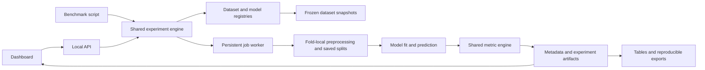

# Urban Air Lab: Product Requirements Document

**Project:** AI-Based Urban Air Quality Prediction and Pollution Hotspot Mapping  
**Version:** 0.1, implementation proposal  
**Date:** 11 October 2026  
**Audience:** academic project team and project reviewers  
**Delivery:** local web dashboard; optional GPU training  
**Repository:** [Urban-Air-Pollution-Mapping](https://github.com/SUBHRO71/Urban-Air-Pollution-Mapping)

This document specifies the project to build. It does not describe an implemented dashboard or measured model performance. Confirmed priorities are academic comparison, a polished demonstration, local execution, optional GPU support, and incremental public GitHub commits. Dataset snapshots, exact hardware, and the implementation stack remain to be selected.

## 1. Product summary

Build a research dashboard where a user selects an air-quality dataset, target, algorithm, and evaluation method, runs an experiment, and receives reproducible metrics and visual results. The algorithm selector must include individual model families and the combined architectures supplied in the photographs. A separate "Run all" workflow and command-line runner must evaluate every registered dataset/model pairing, explain unsupported pairings, and generate a comprehensive, exportable comparison table.

The dashboard should make three tasks easy: run a single experiment, compare a batch, and explain a result during an academic presentation. Forecasting and supported spatial views extend the comparison rather than obscure it. A sleek interface must communicate real data, real training progress, and traceable results.

## 2. Problem and intended users

Air-quality studies use different datasets, features, horizons, models, and validation methods. Their published numbers cannot simply be placed in one ranking. Students need a consistent environment that distinguishes numerical forecasting quality from category accuracy, evaluates combined models against their components, and records the configuration behind every number.

| User | Need | Successful outcome |
| --- | --- | --- |
| Project researcher | Select data and a model without rewriting scripts | A saved experiment with actual predictions, metrics, configuration, and logs |
| Team member | Run repeatable comparisons across the catalog | One batch with complete status accounting and downloadable tables |
| Academic reviewer | Understand the model, split, and limits | Trace a reported score to a dataset snapshot, fold, and prediction file |
| Demonstration viewer | Understand pollutant trends and spatial patterns | Clearly labeled charts/maps with units, forecast time, and data coverage |

## 3. Goals, boundaries, and success

### Required capabilities

1. Support OpenAQ, India Open Government Data air-quality resources, and the original UCI Air Quality dataset through validated adapters; also accept a mapped CSV upload.
2. Offer every supplied architecture and hybrid label, with documented model identities and compatibility requirements.
3. Generate train/validation/test metrics for a chronological holdout and fold-level plus aggregate metrics for ten-fold evaluation.
4. Offer a UI and script that run all registered datasets and models through the same experiment engine.
5. Produce an exceptional comparison table, useful charts, explanatory tooltips, and reproducible exports.
6. Support pollutant forecasts, valid AQI/category evaluation, and spatial views when the data permits them.
7. Work on a local computer with bounded model sizes and optional GPU acceleration.
8. Maintain a public repository with meaningful incremental commits and implementation documentation.

### Success measures

- A first-time user can start a valid experiment within three minutes after a prepared dataset is available, without editing code.
- Every terminal batch entry has a status and reason; failed or skipped runs never disappear from exports.
- Completed ten-fold runs expose exactly ten outer folds, their boundaries, predictions, and metric support counts.
- Every displayed score traces to a saved experiment configuration and dataset checksum.
- At least one supported dataset completes the single-run and batch workflows on CPU using a reference baseline and a temporal deep model before the first demo release.
- The full project release implements all 14 proposed unique supplied architectures, subject to valid inputs; readiness labels alone do not satisfy that release.
- Performance improvements are measured outcomes. No minimum "accuracy" is promised in advance.

### Deferred work

Exact reproduction of all 30 papers; nationwide live monitoring; production health advisories; satellite imagery ingestion; automated causal source attribution; arbitrary drag-and-drop neural architecture construction; multi-user cloud hosting. These can follow the research dashboard. The survey's broader public-warning vision is represented by a labeled research demonstration, not automatic external messaging.

## 4. Data sources and readiness

The named sources are not yet imported datasets. Each runnable option must be a versioned snapshot with a geographic/date selection and a quality report. "All datasets" means all registered snapshots, not all records available globally from a provider.

| Dataset/source | Planned access | Appropriate use | Readiness constraints |
| --- | --- | --- | --- |
| Original UCI Air Quality | Download/import the original CSV or spreadsheet | Gas concentration forecasting and sensor robustness | Handle -200 missing codes; use available gas targets; PM2.5 and geographic grids are absent [S1] |
| OpenAQ | Server-side historical API queries or bounded archive import | Pollutant series and station comparisons | Choose stations, dates, measurement units and aggregation; authenticate API access; check coverage/provider terms [S3] |
| India OGD air quality | Resource-specific CSV/API adapter; historical export import | Indian pollutant/AQI research where source semantics permit | Exact resource, historical coverage, units and averaging windows must be verified; a current snapshot alone cannot support temporal training [S4] |
| UCI Beijing Multi-Site, additional recommended benchmark | Reproducible historical download | Multi-station temporal models and later graph studies | Keep separate from original UCI; acquire validated coordinates or document a training-only statistical graph [S2] |
| User CSV | Upload and map timestamp, target, features, station and optional coordinates | Additional reproducible studies | Validate types, units, time order, sampling frequency, license declaration and target availability |

Original UCI remains in the catalog. Beijing is an additional option motivated by the survey, not a substitute. The UCI resource's conflicting use/license wording must be resolved before redistributing its data; downloading for this academic study and publicly publishing source code are separate decisions [S1]. Raw datasets are excluded from Git by default.

### Dataset contract

Each adapter produces timestamped observations with `timestamp_utc`, source timezone, stable station ID, pollutant/feature values, units, measurement window, availability time where known, quality flags, and optional latitude/longitude. Retain the original payload/file and an adapter version locally. A snapshot manifest records source URL/resource ID, retrieval time, station/date filters, checksum, citation, license status, row counts, sampling interval, missingness, duplicates, and available modalities.

The dashboard must show `Not imported`, `Needs configuration`, `Ready`, `Insufficient history`, or `Failed validation`. Graph-ready and grid-ready are separate capabilities. A source can be ready for a gas forecast and unavailable for a PM2.5 map.

### Preprocessing requirements

- Parse timestamps and timezones explicitly; sort and deduplicate by source/station/time/pollutant using a recorded policy.
- Convert units only through documented transformations. Do not silently convert ppb to mass concentration without the necessary assumptions and inputs.
- Convert source missing codes to missing values. Preserve masks and missingness statistics.
- Resample into configured intervals with recorded coverage thresholds. Do not interpolate target labels for metric computation.
- Fit imputers, scalers, feature selection, dimensionality reduction and learned graph edges only on the training partition of the current fold.
- Use bounded forward fill or training-fit imputation for inputs. Prevent backward fill or interpolation from carrying future observations into past features.
- Construct lag/rolling features using information available at the forecast origin. Future calendar features are allowed; future measured weather is not.
- Record gap/outlier policies. Flag extreme pollution episodes rather than deleting them merely to improve scores.
- Default to hourly forecasting where the source supports it. Never promote daily or annual records to artificial hourly observations.

## 5. Algorithm catalog and combined-model selector

All supplied labels must be discoverable. The selector groups `Reference baselines`, `Temporal models`, `Spatial/graph models`, and `Combined models`; a model can carry multiple searchable tags. Each option shows its architecture, input requirements, runtime class, readiness, and reference lineage.

### Supplied model families

| Canonical ID | Display label | Explicit initial architecture | Required input |
| --- | --- | --- | --- |
| stgnn | Spatio-Temporal Graph Neural Network | Static graph message passing with causal temporal convolution and forecast head | Aligned station histories and a documented graph |
| gcn_lstm | GCN + LSTM | Graph convolution per historical time step, then temporal LSTM and forecast head | Aligned station histories and graph |
| convlstm | ConvLSTM | Convolutional recurrent layers over past spatial grids | Grid sequences, masks and meaningful spatial resolution |
| cnn_lstm | CNN-LSTM / LSTM + CNN | 1D convolution over past observations, then LSTM and forecast head | Historical feature sequences |
| transformer | Transformer | Positional encoding, historical sequence encoder and direct forecast head | Historical feature sequences |
| tft | Temporal Fusion Transformer | Variable selection, recurrent processing, gated attention, static/known/observed feature roles | Sufficient multivariate history and declared feature availability |
| bilstm | Bidirectional LSTM | Bidirectional encoding of the already observed historical window | Historical feature sequences; neither direction reads future targets |
| gru | Gated Recurrent Unit | GRU encoder and forecast head | Historical feature sequences |
| unet | U-Net | Encoder/decoder spatial network using past map channels to predict a future field | Valid grid inputs and independently observed target coverage |
| autoencoder_lstm | Autoencoder-LSTM | Training-only feature reconstruction encoder followed by LSTM forecasting | Historical sequences and masks |

### Additional hybrid options from the photograph

| Canonical ID | Display label | Initial composition |
| --- | --- | --- |
| cnn_bilstm | CNN + BiLSTM | Temporal convolution followed by bidirectional historical-window encoding |
| lstm_attention | LSTM + Attention | Historical LSTM states pooled with temporal attention |
| transformer_lstm | Transformer + LSTM | Historical Transformer representations fed into LSTM forecasting |
| convlstm_attention | ConvLSTM + Attention | ConvLSTM historical map states with declared spatial/temporal attention |

"LSTM + CNN" is provisionally an alias of CNN-LSTM, preserving the supplied label while avoiding duplicate benchmarks. If recurrent-then-convolutional processing is desired, register a separate architecture and ID. There are 15 supplied labels and 14 proposed unique implementations. The family names do not by themselves prove reproduction of STGNN, TFT, AirFormer, or any paper; implementation cards must distinguish `paper reproduction` from `inspired implementation`.

### Reference baselines

Implement persistence, seasonal naive, ARIMA, random forest, histogram gradient boosting, plain LSTM, and plain 1D CNN. These seven references make hybrid gains interpretable. IDW is a separate mapping baseline, outside temporal leaderboard rankings. Kriging is a later mapping extension.

### Interaction and implementation rules

- Choosing `Combined models` reveals the five requested hybrid labels and their component diagrams. Hybrids already present in the ten-family list, such as GCN + LSTM and Autoencoder-LSTM, also appear under that tag.
- A `Compare with components` action includes implemented component models on the same task/splits. Unimplemented components are disclosed.
- Start with named, reproducible hybrid recipes. An unrestricted model-composition builder is deferred.
- Disable incompatible options with an inline reason and accessible explanation; do not run an unrelated substitute under the requested label.
- Implement a common `validate`, `fit`, `predict`, `save`, and `load` adapter contract. Save architecture version, parameters, seed and effective inputs.
- Catalog states are `Planned`, `Implemented`, `Compatible`, and `Unavailable for this dataset`; only implemented and compatible models can run.

An optional later ensemble mode may average aligned component forecasts using preset weights. Learned weights or stacking require inner time-ordered out-of-fold predictions; outer test predictions must never train the combiner.

## 6. Tasks, targets, and experiment settings

The primary task is pollutant concentration regression. AQI regression or category evaluation is enabled only with valid labels/rules. Spatial field prediction is a separate task. Default forecast horizon is one hour, with six and 24 hours available when history and source resolution support them. Default lookback is 24 observations, configurable to 48 or 168 with validation. Horizons represent actual time, not merely row offsets in an irregular file.

The setup form includes dataset/version, stations, date range, target/unit, permitted features, lookback, horizon(s), model, evaluation mode, seed, training preset, device, and optional advanced parameters. Advanced settings include maximum epochs, batch size, learning rate, early-stopping patience, fold block length, minimum training history, and resource limit. Save a named preset.

Use `Quick check` for a clearly labeled reduced-data pipeline demonstration and `Research run` for the full configured snapshot. Quick-check results cannot be mixed into the research leaderboard. Defaults are proposals to be calibrated on the actual computer; they are not benchmark claims.

## 7. Evaluation protocol

### Chronological train/test split

Default outer split: earliest 80% of eligible time blocks for development, latest 20% for holdout evaluation. Within development, reserve its final 10% for validation, yielding approximately 72% training, 8% validation, and 20% holdout before purge/missing-label adjustments. Display actual counts and dates. Offer 70/30 and user-defined chronological cutoffs.

Train only on the training partition; select epochs/settings using validation; evaluate once on the holdout for that run. Report train, validation and holdout metrics separately, with holdout emphasized. If refitting on development is enabled, fix the epoch/configuration from validation and record the refit; distinguish its in-sample metrics from the earlier training metrics.

Multi-station forecasting splits by common timestamps across the network. Shuffling rows or randomly splitting station-time pairs is disallowed in forecast mode.

### Ten-fold time-series cross-validation

For forecasting, label the option `10-fold time-series CV`. Default to ten expanding-window outer folds within the 80% development period. An initial training block is followed by ten disjoint evaluation time blocks; each training prefix precedes its evaluation block. Reinitialize the model and preprocessing for each fold. Inner validation used for early stopping lies wholly within that outer training prefix.

The requested ten folds are a count, not permission to ignore chronology. A conventional shuffled ten-fold option is allowed only for a separately declared independent-row task, with group protection where relevant and a conspicuous task label. It must not be presented as future forecast performance.

### Leakage, fold validity, and repeatability

1. Define splits on forecast origins and label intervals, not arbitrary flattened array indices.
2. Purge any training example whose future label interval reaches the evaluation origin/block. Save the computed purge gap and boundary timestamps. Apply the same rule to inner validation.
3. Historical context before an evaluation origin may be used when actually observed; future holdout labels and future weather observations may not.
4. A preprocessor or autoencoder is fitted anew inside each fold. Statistical graph construction also uses fold training data; fixed coordinate graphs may be reused with a versioned recipe.
5. Require enough usable history for the initial prefix, lookback, target horizon, ten outer blocks, inner validation and purge. Default planning thresholds: at least 168 valid origins for the first training prefix and at least 24 valid target origins per evaluation block, subject to source cadence and task review.
6. If those conditions fail, show `Insufficient history for 10 folds`. Never silently change to five folds or duplicate observations.
7. Save the split manifest once per comparison cohort and share it across algorithms. Freeze eligible target masks and report prediction coverage; incomplete outputs cannot receive a normal leaderboard rank.
8. Set seed 42 by default. Optional repeated-seed experiments report seed variation separately from fold variation. Record device and nondeterministic operations; do not promise bitwise GPU equality.

Ten-fold runs publish fold metrics, sample counts and predictions, unweighted fold mean, sample standard deviation, and separately recomputed pooled out-of-fold metrics. Do not call fold standard deviation a confidence interval: folds share training history and are dependent. Regression metrics, especially RMSE and R2, must be recomputed from pooled predictions rather than averaged under an "overall" label.

### How holdout and CV results are used

Both methods are required and can run through `Both`. They receive separate leaderboard sections because the evaluation populations differ. The 20% holdout never enters development folds, preprocessing or tuning. In an exploratory batch, showing holdout scores for every model creates model-selection exposure; exports must mark this honestly. An optional protected-report mode selects settings/model from development CV before opening a further preregistered untouched period. Without that period, do not claim independently confirmed generalization after repeated leaderboard selection.

### Spatial validation

When claiming predictions for unseen stations or map locations, hold out entire stations or spatial blocks in a separate experiment track. Temporal CV at known stations does not establish that claim. Ten spatial folds require at least ten independent groups; otherwise explain the smaller separately requested protocol. Learned surfaces must be scored against observed held-out truth, not their own interpolated training targets.

## 8. Metrics and AQI semantics

### Regression metrics

| Metric | Definition/handling | Display |
| --- | --- | --- |
| MAE | Mean absolute prediction error on valid observed targets | Target unit; lower is better |
| MSE | Mean squared error | Squared target unit; lower is better |
| RMSE | Square root of MSE | Target unit; lower is better |
| R2 | 1 minus residual sum of squares divided by target total sum of squares | Dimensionless; may be negative; never a percentage accuracy |
| MAPE | Mean absolute percentage error only above a preregistered target-magnitude threshold | Percent plus eligible support; N/A when coverage is inadequate |
| sMAPE | 200 times absolute error divided by sum of absolute truth and prediction, averaged | Percent; both-zero contributes zero; formula/version recorded |
| Baseline skill | 1 minus model MAE divided by persistence MAE on the same samples | Dimensionless; N/A when baseline error is zero |

R2 is N/A for insufficient support or a constant target, with a reason. MAPE's threshold derives from declared measurement resolution or a training-only rule and is saved per target/unit; never hide zero exclusions. Report metrics after inverse-transforming predictions into physical units. Normalized metrics, if retained, are explicitly separate.

### Category and event metrics

When valid AQI categories exist, report accuracy, balanced accuracy, macro precision/recall/F1, per-class precision/recall/F1/support, and a confusion matrix. Compute category predictions consistently from the model output and the selected standard; a dedicated classifier is a separate future task, not implied by a regression model. Report severe-category recall, event probability of detection, false-alarm ratio and critical success index using a saved event threshold. Undefined denominators receive N/A with counts and reason. Declare the category universe; zero-support classes and macro-averaging policy must be visible.

Track training wall time, preprocessing time, total run time, inference milliseconds per sample, parameter count for neural models, and sampled peak process memory. State whether memory/device values are measured or unavailable. Learned probability calibration and interval coverage are optional and only shown when the model actually produces probabilities/intervals.

### AQI rules

Use a versioned standard, defaulting to CPCB for an Indian AQI experiment. Respect pollutant-specific units, averaging windows, completeness and pollutant-coverage rules. Overall AQI is the maximum eligible sub-index; do not average pollutant sub-indices. A single-pollutant value can produce a labeled sub-index/category, not automatically full AQI [S5].

An AQI forecast must construct the required averaging windows from past observations available at issue time and forecast concentrations over the future portion, or use a validated source AQI target. Derive observed target AQI from observed concentrations independently. Report coverage and validity masks. Original UCI gas data lacks the particulate coverage needed for full Indian AQI; its full-AQI accuracy is N/A.

Never define regression accuracy as `100 - MAPE`, R2 multiplied by 100, or any unlabelled conversion.

## 9. Main dashboard workflows

### Single experiment

1. Open `Experiments` and choose a ready dataset snapshot.
2. Inspect its coverage, features, targets, units and available modalities.
3. Choose a target, horizon, model or combined recipe, and `Holdout`, `10-fold time-series CV`, or `Both`.
4. Review the split diagram, actual counts, model compatibility and resource estimate.
5. Start training. Follow validation, preparation, training/fold, prediction and metric stages.
6. Inspect metrics, observed-versus-predicted traces, residuals, fold variation, model settings and supported maps.
7. Save, compare or export the experiment; reopen it from history.

### Batch comparison

1. Open `Benchmarks`; choose `Run all datasets and algorithms` or a filtered subset.
2. Freeze dataset snapshot versions and a target/horizon mapping per dataset. A gas-only dataset may use NO2 while PM2.5 datasets use PM2.5; they get separate comparison cohorts.
3. Preview planned compatible tasks, unsupported pairs, missing imports, estimated fits and resource caps.
4. Start, pause, resume or cancel the batch; view results as each task completes.
5. Filter and compare matching cohorts, expand ten-fold details, and download the full results bundle.

### Required states

First use: explain dataset preparation and offer a small actual-data quick check. Empty history: provide a clear `New experiment` action. Source outage: show cached-snapshot availability. Validation failure: point to fields/rows and a repair action. Training failure: retain logs and partial results. Cancellation: retain completed tasks and label unfinished work. No compatible model: explain the missing modality. Missing geography: show the time-series result and an explicit map-unavailable state.

Mock/demo data must be labeled at every relevant view and excluded from research exports and rankings.

## 10. "Run all" script and execution engine

The UI and planned CLI must invoke the same engine, dataset registry, model registry, split generator and metric code. There must be no second evaluation implementation hidden in the script.

**Proposed interface, not an existing command:**

```text
python -m urban_air.benchmark --datasets all --models all --evaluation both --config configs/research.yaml
python -m urban_air.benchmark --resume <batch-id>
```

The configuration declares snapshot IDs, target/horizon maps, permitted feature profiles, ten-fold block settings, budgets and seeds. `all` expands to a frozen manifest of every registered dataset and canonical model at batch creation. Every pairing receives a disposition, including planned models and missing datasets. Display labels/aliases must not create duplicate jobs.

Job identity includes snapshot checksum, target, unit, feature profile, model/version, architecture settings, split-manifest checksum, evaluation track, horizon, seed, preprocessing version and code revision. A resumed job skips only an identically configured successful artifact. Changed inputs/settings produce a new run; cached provenance must remain visible.

Statuses: `Queued`, `Validating`, `Preparing`, `Training`, `Evaluating`, `Completed`, `Failed`, `Skipped incompatible`, `Unavailable`, `Interrupted`, and `Cancelled`. A batch with a mixture of successes and failures is `Completed with issues`, not an unconditional success.

Default to one training worker on CPU, with bounded numerical-library threads; optional GPU scheduling also starts with one worker. Preflight estimates the number of fits: one holdout plus ten outer folds per seed for `Both`, with any inner tuning/refits separately counted. Large grids/multi-horizon runs must expose their expanded task counts. Runtime estimates remain approximate until a pilot measurement exists.

Pause stops scheduling and safely checkpoints the current trainable model at a boundary; resume restores supported checkpoints or restarts the interrupted fit explicitly. Cancellation sets a cooperative stop signal and preserves completed artifacts. A failed model must not abort unrelated tasks. Retry only appropriate transient failures, with a recorded retry count; memory exhaustion must produce a clear failure or explicit new reduced-resource run, never a silent model change.

Write results atomically and save events as they occur. A browser refresh, closed tab or service restart must not erase completed work. Forecast horizon outputs are scored separately; expanding multi-output neural predictions need not retrain the same model redundantly for each output.

## 11. Comparison table and exports

Default group: dataset snapshot, target/unit, horizon, permitted-input profile, split manifest, evaluation protocol, run preset and seed policy. Ranking is meaningful inside that cohort. Cross-dataset comparisons can use normalized skill in a separate clearly defined analysis; raw CO and PM2.5 errors must not share a single best-model badge.

The main table keeps dataset, model, protocol and status columns pinned. It supports sort, filter, search, column selection, row expansion, saved views and accessible pagination/virtualization. Users can switch `Regression`, `Category/events`, and `Efficiency` column sets rather than face dozens of columns simultaneously.

| Always visible | Regression view | Expanded/detail view |
| --- | --- | --- |
| Dataset/version, target/unit, model/architecture, horizon, protocol, status | Holdout MAE/RMSE/R2; CV mean and standard deviation; skill | All other metrics, train/validation metrics, per-fold values, support, coverage, runtime, memory, settings, reasons and run ID |

Best-value highlighting uses directional indicators and text, with subtle color. Ranking excludes failed, incomplete, incompatible, quick-check, and invalid-coverage rows. Partial folds are marked `7/10 complete`, for example, and cannot receive a complete CV rank. Ties remain ties at displayed precision; sort/rank uses saved full precision and the policy is stated.

A table cell is not a catch-all dash: unavailable values are `N/A` with a reason, queued values say `Pending`, and failed rows say `Failed`. Hover/focus/tap tooltips explain metric meaning, direction, units, aggregation and exclusions. The reason is also accessible in a details panel; essential instructions never depend on hover alone.

**Illustrative schema only; no benchmark values are supplied in this PRD:**

| Dataset | Model | Method | MAE | RMSE | R2 | Category accuracy | Fold completion | Status |
| --- | --- | --- | --- | --- | --- | --- | --- | --- |
| UCI gas snapshot | CNN-LSTM | Holdout | Pending | Pending | Pending | N/A: no valid full AQI | N/A | Not run |
| OpenAQ snapshot | GRU | 10-fold temporal | Pending | Pending | Pending | Depends on valid labels | 0/10 | Not run |
| UCI gas snapshot | U-Net | Both | N/A | N/A | N/A | N/A | N/A | Skipped: grid input absent |

### Required exports

- `summary.csv` and `.xlsx`: one row per run/target/horizon/protocol, status/reason, physical-unit metrics, CV aggregates, support and runtime.
- `fold_metrics.csv`: one row per fold/target/horizon with dates, counts and metrics.
- `predictions.parquet` or CSV: run ID, origin, target timestamp, station/grid reference, fold, target/unit, observation, prediction and validity mask.
- `manifest.json` and resolved configuration: dataset/model/split versions, checksums, code revision, seeds, preprocessing and environment metadata.
- `report.html`: self-contained human-readable comparison, plots, methodology and limitations, with print/PDF support.

Export both filtered and complete views; label the choice. An Excel workbook should contain Summary, Folds, Configuration, and Data Quality tabs with units, readable formatting and filters. Machine-readable numbers remain numeric; status/reason fields are separate. Protect user-supplied text cells against spreadsheet formula injection.

## 12. Interface and visual direction

The proposed identity is an atmospheric research console: deep blue-black surfaces, restrained aqua accents, crisp typography, and precise data graphics. The table and forecast evidence lead; decoration stays quiet. This is an editable recommendation, not a user-approved final identity. The companion [UX design brief](UX_DESIGN_BRIEF.md) specifies tokens and responsive layouts.

Navigation: `Overview`, `Datasets`, `Experiments`, `Benchmarks`, `Forecast & Map`, and `Research`. Show the active dataset/task, job state and snapshot date in a compact header. At desktop width, use a slim left rail, a main evidence canvas and an optional experiment/detail drawer. Do not place a giant marketing hero above the working controls.

`Experiments` presents a short labeled setup flow, split timeline, prominent `Run experiment` action and progressive advanced settings. `Benchmarks` opens with cohort filters and execution status, then a wide comparison table with a synchronized details drawer. `Forecast & Map` combines station/field view, issue-time selector, horizon and observed/predicted distinction. `Research` connects model cards to the 30-paper bibliography.

Charts: observed/predicted line traces, residual distribution, predicted-versus-observed scatter with identity line, fold-error distribution, severe-event confusion matrix where valid, and model error versus runtime. Each offers units, legend, date/timezone, export and an accessible data table. Confidence bands appear only when computed by a documented uncertainty method.

Accessibility target: WCAG 2.2 AA; text contrast at least 4.5:1, visible keyboard focus, screen-reader labels, keyboard table controls, touch targets around 44 px, and reduced-motion support. Never rely on red/green or hover alone. Test at 375, 768, 1024 and 1440 px; the page itself should not horizontally overflow, while a labeled results-table scroll region may.

## 13. Forecasts, maps, and hotspot demonstration

Deliver time-series forecasts first. Spatial output is capability-gated:

- **Station map:** actual station points with observed or predicted concentrations, units, issue time, horizon, coverage and provenance.
- **Interpolated surface:** optional IDW from available points, masked outside supported coverage. Label it an interpolation and disclose resolution/assumptions.
- **Learned grid forecast:** ConvLSTM/U-Net outputs only with validated grids, target masks and an independent evaluation design. Interpolated station labels alone cannot establish genuine dense-field accuracy.

Do not fabricate coordinates or plot a single gas dataset as a city heatmap. Do not infer a precise pixel resolution from the visual rendering. Compare grid models on held-out observed sites or genuine target grids, and report that scope.

Hotspot criteria are configured per pollutant/unit and averaging window. A demonstration list shows location, threshold, predicted value, forecast time and provenance. Separate threshold exceedance from full AQI severity. Confidence scores require calibrated uncertainty; absent uncertainty says `Not estimated`. In-dashboard research warnings are allowed; sending public alerts and making exposure recommendations are outside the first release.

## 14. Proposed architecture

**Recommendation, pending implementation choice:** React with TypeScript and a modern build tool for the interface; FastAPI for local APIs; PyTorch for neural models; scikit-learn for reference ML/preprocessing/metrics; statsmodels for ARIMA; SQLite for metadata; Parquet and local files for predictions/checkpoints. Use a persistent Python worker outside web request handlers. Redis and cloud services are unnecessary for a single-computer first release.

Use a chart library supporting zoom/tooltips and a map library supporting station layers and geographic masks. Pin dependency versions after environment/hardware validation. Build a container option after native Windows execution works; containers are optional rather than a prerequisite.



The PRD's architecture is a recommendation, not installed software or running endpoints. Planned API groups cover dataset import/readiness, model catalog/compatibility, experiment creation/status/cancellation, batch preview/control, results/folds/predictions, and exports. Use stable IDs and schema versions.

### Persistent records

| Record | Minimum fields |
| --- | --- |
| DatasetSnapshot | Source/resource, checksum/version, filters, schema/units, timestamp bounds, quality and license status |
| ModelDefinition | Canonical ID/aliases, architecture/version, input contract, readiness, defaults, references |
| SplitManifest | Task/protocol, origin and label boundaries, station groups, fold IDs, purge rules, sample-mask checksum |
| ExperimentRun | Configuration hash, snapshot/model/split IDs, target/horizon, seed, preset/device, code revision, status/times |
| FoldResult | Fold boundaries, support, coverage, metrics, training config, prediction/artifact paths |
| BatchRun | Frozen pairing list, status counts, resource limits, job order, pause/resume state |
| Artifact | Run ID, kind, file checksum, format/version, provenance and local path |

## 15. Quality and operational requirements

- Keep the interface responsive while training. Status updates should appear within two seconds under ordinary local load; record actual performance on the chosen computer.
- Target initial cached dashboard load under three seconds and common metadata interactions under 500 ms on the declared reference machine. These are engineering targets, not measured current performance.
- Support at least 10,000 result rows through pagination/virtualization and bounded chart downsampling; metrics always use full evaluated predictions.
- Load immutable cached snapshots offline after preparation; API outages must not invalidate completed experiments.
- Recover completed records after worker/service restart; interrupted fits remain explicitly recoverable or restartable.
- Log validation, fold boundaries, model settings, progress and failures with credential redaction. Store credentials server-side and outside Git.
- Bind locally by default. Validate uploads, cap file/resource sizes, reject executable uploads, and constrain imported paths to the configured data area.
- Record environment/device versions and numerical precision. Reproduction tolerances must be declared; third-party data licenses are separate from project source-code licensing.
- Keep exported academic plots and tables free of personal source-document details. Raw data, trained weights and large output files remain ignored unless intentionally shared with verified terms.

## 16. Delivery plan and GitHub workflow

The public repository is the development record. Use small coherent commits for completed increments; push regularly. Commit messages should describe the feature or fix. Every release documents what works, dependencies, execution steps and remaining limits. Main must not claim unsupported features are complete.

| Milestone | Deliverable | Exit condition |
| --- | --- | --- |
| M0: planning | PRD, product context, research notes, visual brief | Requirements and unresolved data choices are explicit |
| M1: data and evaluation | UCI/CSV adapter, snapshot registry, shared metrics and chronological splitting, persistence/RF | Real CPU run with independently checked metrics and no leakage |
| M2: usable experiment dashboard | Dataset picker, temporal model/hybrid recipe, progress, charts, history and export | User completes one experiment and reopens its evidence |
| M3: benchmark workflow | Same-engine CLI/UI batch, both evaluation methods, resume and full table | Every planned pairing is accounted for; ten-fold evidence exports correctly |
| M4: full temporal catalog | LSTM/CNN/GRU/BiLSTM, attention/Transformer/TFT/autoencoder hybrids, OpenAQ and verified India adapters | Implemented catalog entries run on compatible frozen data |
| M5: spatial catalog | STGNN, GCN-LSTM, ConvLSTM, U-Net, ConvLSTM-Attention; maps and spatial validation | All required unique architectures implemented with honest modality gates |
| M6: academic release | Research benchmark, model component comparisons, documented limitations and reproducible demo | Acceptance checks below pass; all required workflows demonstrated |

Milestones are ordered dependencies, not promised calendar durations. Spatial datasets are a critical dependency and should be investigated during M1 rather than discovered only at M5. No training or site deployment is implied by M0.

Suggested commits: data adapter and quality validation; shared splitting/metrics; first actual baseline; experiment API/worker; UI setup/results; batch CLI; comparison table/export; each model family; maps; reproducibility/report. Credentials and source attachments are never committed.

## 17. Acceptance criteria

| ID | Scenario | Required proof |
| --- | --- | --- |
| AC-01 | Import each supported source/CSV | Versioned snapshot, schema/unit/time checks, quality report; provisional sources cannot masquerade as ready |
| AC-02 | Search all supplied labels | All ten architecture and five hybrid labels found; alias and 14 unique IDs explained |
| AC-03 | Complete the project catalog | Each of the 14 unique supplied architectures has real fit/predict artifacts on suitable input; labels alone are insufficient |
| AC-04 | Run chronological holdout | Actual train/validation/holdout dates/counts; predictions and independently recomputed regression metrics |
| AC-05 | Run ten-fold forecasting | Ten chronological disjoint outer test blocks, fold-local preprocessing and saved purged boundaries |
| AC-06 | Short or incompatible data | Specific unavailable status; no smaller-fold substitution, fake coordinates or replacement model |
| AC-07 | Prove leakage protection | Sentinel future values cannot change earlier fitted preprocessing/features; train label intervals respect evaluation origins |
| AC-08 | Prove numerical correctness | Small known-target fixture independently verifies MAE/MSE/RMSE/R2; constant/zero targets and undefined denominators tested |
| AC-09 | Prove metric aggregation | Fold means/std and recomputed pooled metrics agree with exported prediction evidence; missing folds are visibly incomplete |
| AC-10 | Evaluate AQI/category | Verified breakpoint/window/completeness cases; original UCI full-AQI N/A; class supports and confusion matrix reconcile |
| AC-11 | Run all | UI and CLI produce the same configured results; every registry pairing gets a saved disposition |
| AC-12 | Interrupt and resume | Completed task remains intact; same config avoids duplicate success; changed checksum/settings create a new run |
| AC-13 | Isolate a model failure | One failed model leaves unrelated queued tasks runnable and its logs/reason exportable |
| AC-14 | Inspect comparison table | Matching cohorts only for rankings; all metrics accessible; sort/filter/pin/fold detail and N/A reasons work |
| AC-15 | Inspect exports | Summary, folds, configuration, quality and predictions agree; all numeric metrics preserve units/precision |
| AC-16 | Validate maps | Measured, predicted, interpolated and learned layers labeled; unseen-location claims backed by spatial holdout |
| AC-17 | Validate UI | Keyboard-only flow, contrast, focus/tooltips, reduced motion and four responsive widths inspected |
| AC-18 | Reproduce academic demo | Clean checkout plus documented snapshot preparation/config produces a real local run within declared numerical tolerance |
| AC-19 | Validate history/security | Refresh/restart preserves evidence; exported logs and Git contain no credentials or private reference details |

Testing should concentrate on metric correctness, leakage boundaries, job persistence, batch parity and critical user flows. Use visual inspection for design refinements; avoid large suites of tests that only mirror cosmetic implementation.

## 18. Risks, decisions, and next implementation gates

| Risk/open decision | Response |
| --- | --- |
| India resource lacks coherent historical observations | Verify a historical resource/export; keep latest snapshots for demonstration only until sufficient history exists |
| Graph/grid prerequisites unavailable | Investigate sources early; show modality gates; use a separately labeled interpolation view while procuring genuine spatial truth |
| All-model ten-fold training is slow on CPU | Pilot, estimate fits, cap workers/epochs/model sizes, enable optional GPU, checkpoint and resume |
| Hybrid names are ambiguous | Publish explicit component order and alias policy; register different architectures under distinct IDs |
| Published metric numbers appear incomparable | Keep literature reports out of experimental leaderboards; compute all project numbers from saved predictions |
| Repeated comparison overfits holdout | Mark exploratory comparisons and reserve a further untouched report period where feasible |
| AQI semantics or source units uncertain | Block full AQI until standard, averaging windows and coverage are validated |
| Interface looks polished but backend is incomplete | Label model/source readiness and release scope honestly; acceptance requires genuine runs |

Next gates: choose the exact India historical resource and OpenAQ snapshot, inspect actual local hardware, confirm an implementation stack, and verify a graph/grid data route. These decisions do not block this planning deliverable; they must be resolved before the corresponding implementation milestone.

## 19. References and traceability

The supplied survey and photographs are represented by [research notes and the numbered 30-paper bibliography](RESEARCH_NOTES.md). They inform the proposal; their reported results are not this project's metrics. Selected primary references and data/evaluation resources were checked on 11 October 2026.

- **S1:** [Original UCI Air Quality](https://archive.ics.uci.edu/dataset/360/air+quality).
- **S2:** [UCI Beijing Multi-Site Air Quality](https://archive.ics.uci.edu/dataset/501/beijing+multi+site+air+quality+data).
- **S3:** OpenAQ [API authentication](https://docs.openaq.org/using-the-api/api-key), [measurements](https://docs.openaq.org/resources/measurements), and [bulk archive](https://docs.openaq.org/aws/about).
- **S4:** [India OGD real-time resource](https://www.data.gov.in/resource/real-time-air-quality-index-various-locations), access/semantics verification still required.
- **S5:** [CPCB National AQI report](https://airquality.cpcb.gov.in/ccr_docs/FINAL-REPORT_AQI_.pdf).
- **S6:** [scikit-learn TimeSeriesSplit](https://scikit-learn.org/stable/modules/generated/sklearn.model_selection.TimeSeriesSplit.html), reference behavior; project-specific purging remains an explicit additional requirement.

User-authorized scope is the source of requirements. Added defaults, stack choices, thresholds, alias handling and visual tokens are proposed design/engineering decisions and remain editable.
